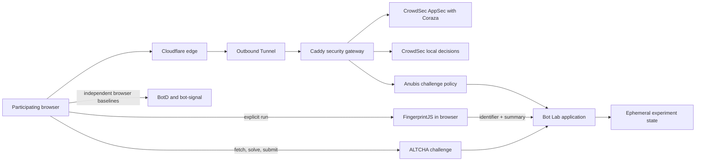

# Bot Lab

Bot Lab is a privacy-bounded environment for studying browser signals, proof of
work and layered web defences. It is designed for a dedicated lab hostname,
not as a challenge in front of the public portfolio.

This repository is a public, squashed source snapshot. Deployment-specific
registry, hostname, secret and cluster values in `k8s/` are fail-closed
placeholders and must be replaced before use.

## What it demonstrates

- FingerprintJS v5 collection initiated only by an explicit button.
- An expandable local inspector for all collected components, with full values,
  search, category filtering, plain-language descriptions and an explicit
  raw-data transmission boundary.
- Per-tab comparison of repeated visitor identifiers and component counts.
- ALTCHA v3 Web Component backed by an ALTCHA v2 signed PBKDF2 challenge.
- Two-minute challenge expiry and server-side one-use replay protection.
- Per-client fixed-window rate limits without retaining an IP address.
- Hard ceilings on both rate-limit buckets and outstanding challenges so the
  defensive state cannot grow without bound under a many-source flood.
- Ephemeral HMAC transformation of browser identifiers.
- A capped 15-minute in-memory observation window with aggregate-only public
  statistics.
- Bounded, self-declared experiment contexts for ordinary, private and
  authorised-automation runs.
- A thresholded comparison report and local JSON export that never expose
  fingerprint or session tags.
- Transparent deterministic shadow scoring with fixed weights, cohort-level
  evaluation and an explicit no-enforcement guarantee.
- Zero-weight client-hint platform/mobile coherence measurements that retain
  booleans only and cannot change a score or enforcement decision.
- Shadow-only browser-major and browser-family coherence rules that compare
  User-Agent and Chromium Client Hints transiently while retaining only bounded
  mismatch booleans. Missing hints remain unavailable evidence.
- Invalidated window-inset scoring is removed after an ordinary mobile/touch
  control reproduced the same shape. WebGL and speech-voice hypotheses also
  remain unscored because they did not distinguish the tested clients.
- A shadow-only Navigation Timing category retains only recognised, opaque or
  unavailable protocol evidence—never the protocol or timing values. Cache,
  service-worker and privacy-mediated responses may also appear opaque.
- A pinned open-source BotD baseline evaluated separately from the custom score.
- A unified tri-state adapter report that keeps custom shadow, BotD, bot-signal,
  gateway evaluations and optional comparators independent instead of merging
  them into an opaque score.
- The exact self-hosted `bot-signal` v2.0.14 instant browser layer, with no
  telemetry, external services, IP/TLS/reputation inputs or effect on the
  custom score. Its observed detector misses and mobile-shaped false positive
  remain visible limitations rather than hidden behind a combined verdict.
- Optional `bot-signal` behavior observation starts only after an explicit
  button press. Raw paths and typing-event samples remain in page memory; only
  a tri-state and closed upstream category names reach the server.
- A pinned Rebrowser compatibility record remains unavailable and unshipped
  because the reviewed revision lacks a complete licence/package/runtime
  boundary suitable for this public self-hosted application.
- Optional short-lived, nonce-bound HMAC proof for known-good first-party
  automation without bypassing detection or enabling enforcement.
- A repeatable labelled browser campaign with adaptive plateau stopping across
  distinct Chrome and Opera GX profiles, plus digest-pinned Coraza/OWASP CRS
  observation and enforcement smokes using generated local traffic only.
- A unified defensive-layer evaluation that exercises BotD, Coraza, Anubis and
  CrowdSec with aggregate-only synthetic scenarios and verified cleanup.
- A dedicated Caddy gateway that joins CrowdSec's local decision engine and
  Coraza-based AppSec inspection without modifying the shared ingress stack.
- A narrowly scoped Anubis proof-of-work demonstration on `/protected-demo`
  with light browser and stronger crawler-labelled tiers; the main page,
  assets, APIs and health checks remain challenge-free.
- A session-only entry notice that states the authorised red/blue-team scope,
  active-defence behavior, synthetic-data requirement and security retention
  boundary without pretending to be access control.
- Ten-minute server-signed HttpOnly browser sessions, request-header coherence,
  and bounded interaction timing/count summaries for application-layer study.
- An explicitly loaded Cloudflare Turnstile comparison with mandatory server-
  side Siteverify plus expected hostname and action checks.
- Restrictive browser security headers and no passive third-party runtime
  requests. FingerprintJS monitoring is disabled and ALTCHA assets are
  self-hosted, so the CSP needs neither `unsafe-inline` nor `unsafe-eval`.
- Crawl-friendly `robots.txt` paired with response-level `noindex`, so polite
  red-team clients can participate without making the lab search-indexable.

The open-source FingerprintJS identifier is client-generated and spoofable. It
is evidence for an experiment, not an authentication or authorization claim.

## Local development

```bash
npm ci
npm run check
npm start
```

After a production release, `npm run smoke:public` performs a bounded negative-path check against
the public lab. It verifies secure session-cookie attributes and proves unsigned observations,
tampered sessions and a forged Turnstile token are rejected without collecting a fingerprint or
enabling enforcement.

`npm run campaign:redblue` runs the synthetic localhost-only browser matrix. Each condition stops
after three identical aggregate signatures or after five attempts. It emits no visitor, fingerprint
or session identifiers and leaves enforcement off.

`npm run campaign:detectors:controls` compares fresh headed unbranded Chromium,
Chrome, Opera and a mobile-shaped ordinary control. It exports only aggregate
tri-state and closed-category outcomes and fails if passive external browser
requests occur.

`npm run evaluate:defenses` runs the complete labelled campaign against the local browser matrix and
the authorised homelab deployment. It uses only RFC 5737 addresses for in-cluster probes, requires
three matching outcomes per scenario, removes every temporary CrowdSec decision and emits no
identifiers. CrowdSec, Coraza/CRS and Anubis results use the independent
tri-state adapter shape while remaining aggregate gateway evidence.

`GET /api/detector-report` returns every layer independently with provenance,
availability, aggregate outcomes and explicit limitations. Declared context
groups predictions only after detection. The report contains no identifiers,
raw components, request headers, stacks, behavior paths, typed content, IP
addresses or TLS data, and every adapter remains non-enforcing.

The service listens on port `8080` by default. Set `PORT` and `HOST` for a
different local binding. `ALTCHA_COST` controls PBKDF2 work; the default is
`750`. The container sets `TRUST_CLOUDFLARE=true`, so the public deployment must
remain reachable only through the trusted Cloudflare Tunnel path.

## Request flow



## Operational limits

- One replica only: process-local replay and observation state is intentional.
- Bot Lab experiment state has no database or backup requirement; restart is
  the reset and recovery path.
- CrowdSec's local database and Anubis challenge state use ephemeral storage.
  A restart forgets them, and CrowdSec also flushes security addresses within
  24 hours.
- CrowdSec pulls community and subscribed blocklists but has signal sharing
  disabled. Participant addresses stay inside the homelab gateway and are
  excluded from both CrowdSec contributions and Bot Lab reports.
- CrowdSec/Coraza rejects CRS and virtual-patching matches. Anubis challenges
  only the named demonstration route. The browser shadow score remains report-only.
- Shadow scores in v0.3 are report-only. Declared context is evaluation truth,
  never a scoring input, and no score blocks, delays or challenges a request.
- No raw request headers, pointer coordinates, typed content or persistent
  behavior profiles are retained.
- Turnstile is disabled when its production sitekey and secret are absent; its
  third-party script is loaded only after an explicit participant action.
- No promise of human identification, bot-proof classification, CAPTCHA
  resistance, or protection against distributed abuse.
- Context labels are participant declarations. The webdriver flag and
  fingerprint stability are measurements, not proof of client identity.
- Kubernetes NetworkPolicy is intentionally absent while the cluster uses
  Flannel without a verified policy-enforcement layer.

## Deployment

Build and push an immutable image, resolve its registry digest,
replace the fail-closed digest placeholder in `k8s/workload.yaml`, and let Argo
CD reconcile the manifests. Create any registry or application Secrets through
your cluster's approved no-output credential workflow. Add public ingress only
after the in-cluster service passes its health and privacy checks.

Keep the resolved registry digest as the deployment integrity boundary. The
example Argo CD Application points at this repository's `k8s/` directory.
